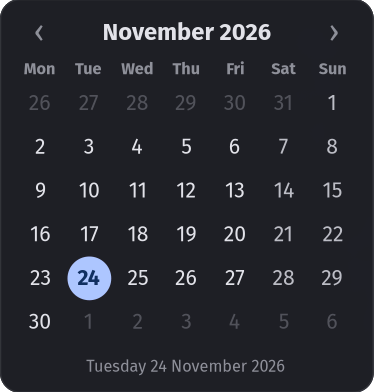

# calpop

A calendar popup for Wayland bars. Run it from your bar's clock, or from a key if your bar
cannot run a command on click: a small month calendar opens against the bar (the `[position]`
setting puts it right under the clock). Run it again, press `Esc`, or click anywhere else on
that screen: it closes.

<p align="center"></p>

It is a calendar, nothing more: no agenda, no events, no reminders, no network access.

- Opens anchored to your bar, where you want it (left, center or right, top or bottom, any screen)
- Follows your theme: colors can come from your Waybar, matugen, wallust, pywal or Omarchy theme file,
  read each time it opens, so it changes with your wallpaper
- Month navigation with the arrows, the mouse wheel (one notch, one month) or the keyboard (Vim keys too)
- Day and month names in your language, week starting on Monday (or the day you choose)
- Optional week numbers, counted the right way: ISO 8601, US, or the rule of your locale
- Everything in one commented file; any GTK4 CSS on top for the rest
- Starts in about 0.3 s and uses about 27 MB while open, nothing once closed

## Requirements

- A Wayland compositor with the **wlr-layer-shell** protocol: Hyprland, KDE Plasma, Sway, river,
  niri, Wayfire, labwc… **GNOME is not supported** (no layer-shell), neither is X11:
  calpop says so and exits.
  Tested on Hyprland 0.57 with Waybar 0.16, and on KDE Plasma 6.8 (opened with a shortcut).
- GTK 4.12 or later and [gtk4-layer-shell](https://github.com/wmww/gtk4-layer-shell).
- To build it: Rust 1.93 or later.

## Install

Both ways build calpop on your machine. First install Rust and the GTK 4 and gtk4-layer-shell
development packages:

```sh
sudo pacman -S --needed rust gtk4 gtk4-layer-shell           # Arch
sudo apt install cargo libgtk-4-dev libgtk4-layer-shell-dev  # Debian 13, Ubuntu 26.04+
sudo dnf install cargo gtk4-devel gtk4-layer-shell-devel     # Fedora 43+
```

If your distribution's Rust is older than 1.93 (Debian 13 ships 1.85), install a current one
with [rustup](https://rustup.rs) instead.

### From crates.io

```sh
cargo install calpop
```

This puts `calpop` in `~/.cargo/bin`, which must be in your `PATH`. It does not install the
man page: for `man calpop`, build from source.

### From source

```sh
git clone https://github.com/Mirilindo/calpop
cd calpop
cargo build --release
install -Dm755 target/release/calpop ~/.local/bin/calpop
install -Dm644 calpop.1 ~/.local/share/man/man1/calpop.1
```

## Use it with Waybar

In your Waybar config, give the clock a click command. The old calendar tooltip
(`{calendar}`, `"calendar": {…}`) can go:

```jsonc
"clock": {
    "format": "{:%H:%M}",
    "tooltip-format": "Left: calendar",
    "on-click": "calpop"
}
```

Running `calpop` while it is open closes it, so the same click opens and closes it.

### Other bars, or a key

calpop is a plain program: anything that can run a command can open it. For example a key:

```lua
-- Hyprland (hyprland.lua)
hl.bind("SUPER + C", hl.dsp.exec_cmd("calpop"))
```

```
# Sway
bindsym $mod+c exec calpop
```

On KDE Plasma: System Settings › Keyboard › Shortcuts › Add New › Command or Script…,
then `calpop` and the key you want.

## Configuration

Settings live in `~/.config/calpop/config.toml` and are read each time the popup opens.
Every key is optional. Start from a file that lists them all, with their defaults:

```sh
mkdir -p ~/.config/calpop
calpop --default-config > ~/.config/calpop/config.toml
```

The same file is in [`examples/config.toml`](https://github.com/Mirilindo/calpop/blob/main/examples/config.toml). The essentials:

```toml
first_day = "monday"      # monday … sunday, or "locale"
week_numbers = false
locale = ""               # e.g. "en_US.UTF-8"; empty = your LC_TIME

[position]
edge = "top"              # top | bottom: where your bar is
align = "center"          # left | center | right
margin_x = 8              # px from the screen edge, to sit under your clock
margin_y = 6              # px from the bar

[font]
size = 14                 # the whole popup scales with it
```

A typo is reported, with the list of valid keys, instead of being ignored.

### Follow your theme

Point `theme` to your color file, then write colors as `@name`:

```toml
theme = "~/.config/waybar/colors.css"   # lines like: @define-color primary #adc6ff;

[colors]
background = "@surface_container"
foreground = "@on_surface"
muted      = "@outline"
accent     = "@primary"
on_accent  = "@on_primary"
border     = "@surface_container_highest"
hover      = "@surface_container_high"
```

Three formats are read: `@define-color name #rrggbb;` (GTK, Waybar, matugen, wallust),
`--name: #rrggbb;` (CSS variables, pywal) and `name = "#rrggbb"` (Omarchy). With Omarchy:

```toml
theme = "~/.config/omarchy/current/theme/colors.toml"

[colors]
background = "@background"
foreground = "@foreground"
muted      = "@muted"
accent     = "@accent"
on_accent  = "@background"
border     = "@selection"
hover      = "@selection"
```

If the file is missing or a name is unknown, calpop says which one and uses the default color.

### Week numbers

There is more than one way to count weeks. On 1 January 2027, ISO 8601 says week 53 (of 2026)
and the US rule says week 1. `week_numbering` picks the rule:

| Value | Rule | Used in |
|---|---|---|
| `iso` (default) | weeks start on Monday, week 1 holds the first Thursday | Europe, ISO 8601 |
| `us` | week 1 holds January 1st, weeks start on `first_day` | US, Canada, Middle East… |
| `locale` | the rule of your `LC_TIME` locale | |

Both rules were checked against independent references for every day from 1900 to 2100.

### Styling

A `style.css` next to `config.toml` is applied last, with any GTK4 CSS:

| Class | Element |
|---|---|
| `.calpop-root` | the popup |
| `.title`, `.nav` | month and year, arrows |
| `.weekday` | Mon, Tue… |
| `.week` | week numbers |
| `.day` | days, plus `.today`, `.weekend`, `.other` (days of other months) |
| `.footer` | today's full date |

```css
.day { font-weight: bold; }
.today { border-radius: 6px; }   /* a square instead of a circle */
.weekend { color: #e06c75; }
```

### Hyprland: blur and animation

The popup's layer is named `calpop`. For a blurred background (with `opacity` below 1)
and a slide-in animation, in `hyprland.lua` (Hyprland 0.57+):

```lua
hl.layer_rule({
    name = "calpop",
    match = { namespace = "^calpop$" },
    blur = true,
    ignore_alpha = 0.5,        -- don't blur the transparent corners
    animation = "slide top",
})
```

Match `^calpop$` exactly: a second, invisible layer named `calpop-backdrop` covers the
screen to catch clicks outside the popup, and blurring it would blur the whole screen.

## Keys

| Key | Action |
|---|---|
| `←` `→` / `h` `l` / `Page Up` `Page Down` | previous / next month |
| `↑` `↓` / `k` `j` | previous / next year |
| `Home` / `t` | back to today |
| `Esc` / `q` | close |

While open, calpop takes the keyboard, like a menu. Clicking the title or the date at the
bottom also goes back to today.

## Credits

Inspired by [waycal](https://github.com/forrestknight/waycal) by Forrest Knight (MIT).

## License

[MIT](https://github.com/Mirilindo/calpop/blob/main/LICENSE)
